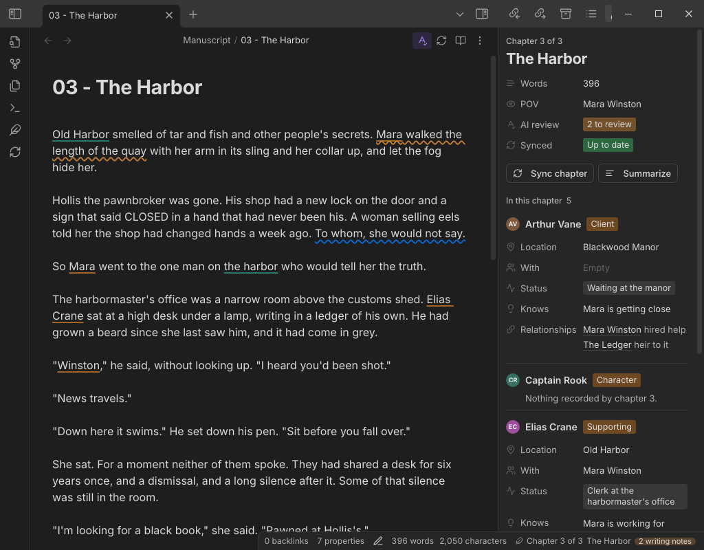
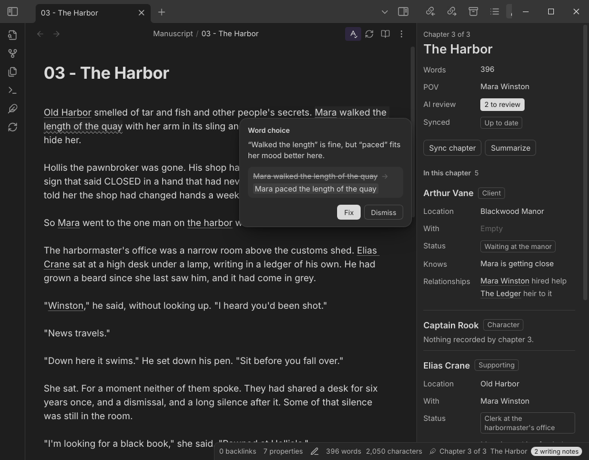
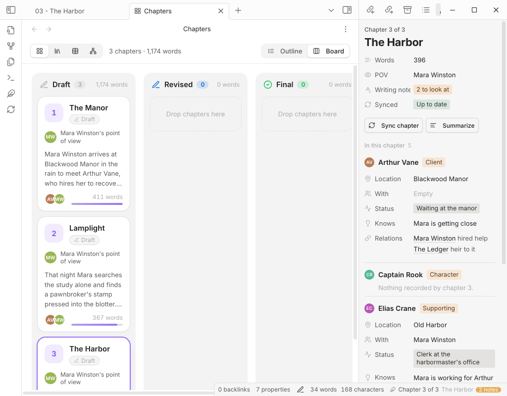
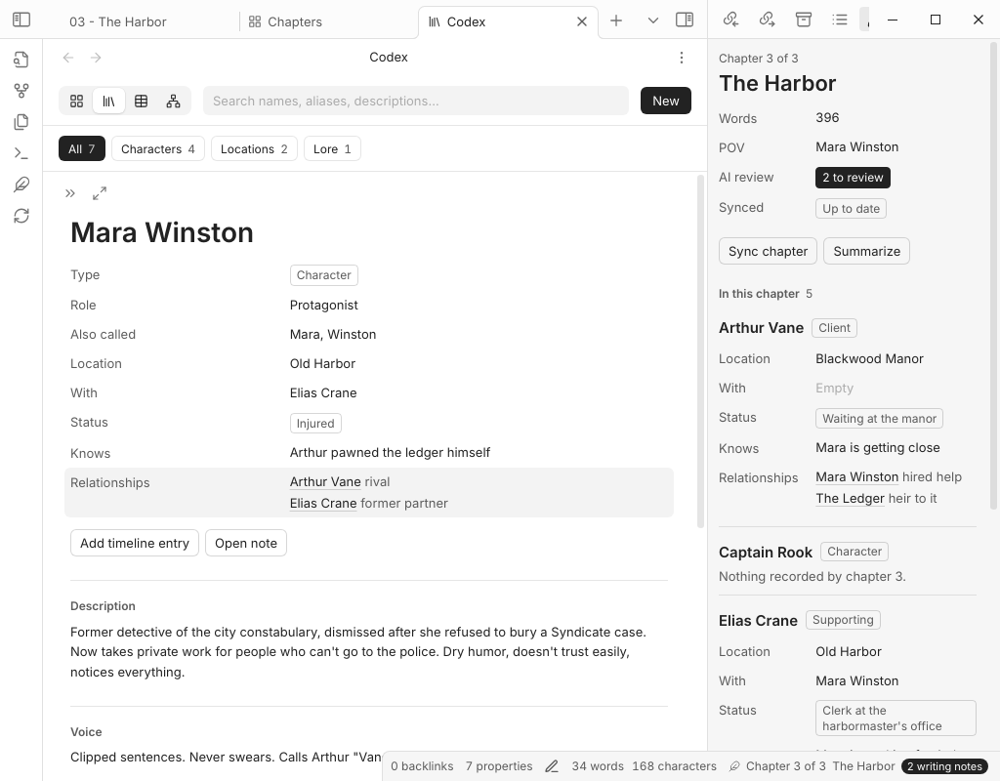
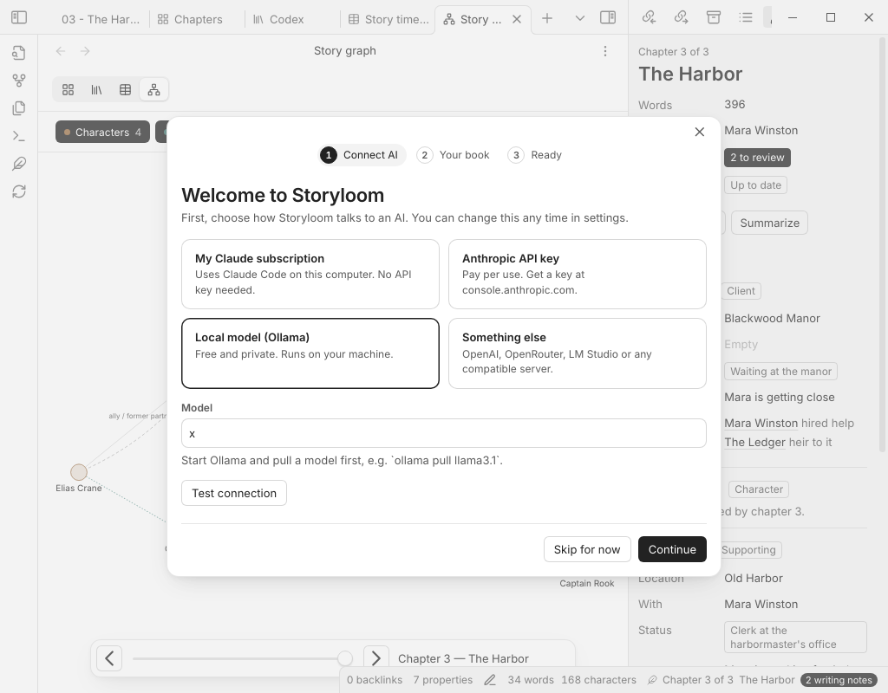

<div align="center">

# 🧶 Storyloom

**An AI writing studio for novelists, living inside Obsidian.**

*Write your book. Storyloom keeps track of it.*

[](https://obsidian.md)
[](manifest.json)
[](LICENSE)
[](#-connect-an-ai)



</div>

---

You're on chapter 23. Where was Mara in chapter 9? Does Elias know about the ledger yet? Were those two still friends when the fire happened?

**Storyloom remembers so you don't have to.** Finish a chapter, click **Sync chapter**, and the AI reads it and records what changed: who moved, who learned what, who stopped trusting whom. Hover any name in your manuscript to see that character *as of the chapter you're in*. It also gives you Sudowrite-style writing tools and a proofreader that underlines the "their" that should be "there".

It's all plain Markdown in your vault. No hidden database, no lock-in, no subscription to us.

## ✨ What's in the box

### 🪄 Ask AI, right where you write
Select a passage, press **⌘K** / **Ctrl+K** (or click the little **Ask AI** pill), and say what you want: *"tighter"*, *"more dread"*, *"show, don't tell"*. A floating glass panel streams the new version in and shows a word-by-word diff. **Tab** keeps it, **Esc** throws it away, and one undo brings the original back. With nothing selected, it writes at the cursor.


### 🔄 Sync chapter: a story bible that writes itself
When you finish a chapter, hit **Sync chapter**. You'll find it in the ribbon, at the top of every chapter and in the Cast panel. Storyloom reads the chapter and writes the changes into your codex: new locations, injuries, secrets learned, alliances made and broken, and new characters as they show up.

- **The chapters are the source of truth.** By default there's nothing to approve. Rewrite the chapter, sync again, and the codex follows. Storyloom replaces exactly what its last sync wrote and never touches lines you typed by hand.
- **It tells you when it's out of date.** A dot on the Sync chapter button means the chapter changed since its last sync.
- **It survives reordering.** Drag chapter 7 to position 3 and every timeline line and relationship range follows it.

### 🔍 AI review: a proofreader that stays in its lane
While it syncs, Storyloom also proofreads the chapter. It looks for typos, grammar, words used with the wrong meaning (*their/there, affect/effect, peak/peek*), run-on sentences and clunky repetition. **It never touches your story**: no plot opinions, no "have you considered a dragon".

Each writing note is a wavy underline. Hover it to see what's wrong, then **Fix** it in one click or **Dismiss** it. Turn AI review on or off with the spell-check button at the top of any chapter.



### 👥 The Cast panel
A side panel that follows you from chapter to chapter. For everyone in the scene it shows where they are, who they're with, how they're doing, what they know and who they're tangled up with, all *as of this chapter*. It also shows the chapter's word count, point of view and sync status.

### 📚 Chapters, Codex, Timeline, Graph
Four views that share one tab bar and swap in place, so they feel like one app.

| | |
|---|---|
| **Chapters.** A card per chapter with summary, POV, cast and word count. Drag to reorder, or focus a card and press **Alt+←/→** (the codex follows). You can also switch to a **Draft → Revised → Final** board. | **Codex.** Every character, place and piece of lore, with search, type filters and a Notion-style side peek. |
|  |  |
| **Timeline.** One lane per character and one column per chapter. Locations are colored bars across the chapters someone stays put; hover any square to see them at that moment. | **Graph.** Your cast as a network. Drag the chapter slider and watch relationships form and fall apart. |
|  |  |

### 🛠️ And the rest of the toolbox
- **Writing tools:** Continue writing, Rewrite (2–3 versions), Describe (five senses), Expand, Brainstorm, Summarize chapter, Critique and Continuity check (click an issue to jump to the line). They're in the command palette and on the right-click menu.
- **Story assistant:** a chat that knows your codex and chapter summaries. Type `@` to pull in a character or chapter.
- **Housekeeping:**
  - New chapter (auto-numbered) and new character, location or lore entry;
  - next and previous chapter;
  - word count by chapter;
  - Export manuscript;
  - a status-bar item for the current chapter.
- **A friendly setup guide** connects your AI and creates the folders, templates and Book note your story needs.

<div align="center"></div>

## 📦 Install

**Option 1: try the sample book (recommended for a first look).**
1. Download or clone this repo.
2. Run `npm install && npm run vault`.
3. Open the **`My Book/`** folder as a vault in Obsidian, and choose **Trust author and enable plugins**.
4. Open `Start Here.md` and take the tour of a little detective story that's already set up.

**Option 2: add it to your own vault.**
1. Grab `main.js`, `manifest.json` and `styles.css` from the [latest release](../../releases), or build them with `npm install && npm run build`.
2. Put them in `<your vault>/.obsidian/plugins/storyloom/`.
3. Enable **Storyloom** under **Settings → Community plugins**.
4. The setup guide takes it from there.

> Storyloom isn't marked desktop-only, but it's built and tested on desktop. The **Claude Code** provider needs desktop, because it runs the Claude Code app on your computer.

## 🤖 Connect an AI

Bring your own. Storyloom never sends your writing anywhere except the provider you pick.

| Provider | Why you'd pick it |
|---|---|
| **Claude Code** (your Claude subscription) | Already pay for Claude Pro or Max? Storyloom runs the Claude Code app on your computer, so there's no API key. Storyloom never reads, stores or forwards your Claude login. |
| **Anthropic** (API key) | Pay per use, with prompt caching so long books stay cheap. The default model is `claude-sonnet-5-5`. |
| **OpenAI · OpenRouter** | Any model they serve. |
| **Ollama · LM Studio** | Free, private and offline, running on your own machine. |
| **Custom** | Any OpenAI-compatible endpoint. |

Answers stream in as they're written. With Anthropic, your book's stable context (codex, summaries, style guide) is sent as a cached block, so repeated requests on the same chapter only pay full price for the chapter itself.

## ⌨️ The good stuff, at your fingertips

| Do this | How |
|---|---|
| Ask AI about a selection | **⌘K** / **Ctrl+K**, or the **Ask AI** pill |
| Keep or toss the suggestion | **Tab** / **Esc** |
| Sync the chapter | 🔄 in the ribbon or the chapter's header, or *Sync chapter* in the command palette |
| Turn AI review on or off | The spell-check button at the top of the chapter, or the Storyloom menu |
| Jump to the next writing note | *Go to next writing note* |
| See a character as of this chapter | Hover their name. **⌘/Ctrl-click** opens their note. |
| Move a chapter | Drag its card, or focus it and press **Alt+←/→** |
| Open everything else | The 🪶 **Storyloom** button in the ribbon |

## 🗂️ How your story is stored

Everything is a normal note you can read and edit:

```
My Book/
├── Book.md                 premise, style guide, voice sample
├── Manuscript/
│   ├── 01 - The Manor.md   type: chapter, chapter: 1
│   └── 02 - Lamplight.md
└── Codex/
    ├── Characters/Mara Winston.md
    ├── Locations/Old Harbor.md
    └── Lore/The Ledger.md
```

A codex note keeps its history in two plain sections:

```markdown
## Relationships
- [[Arthur Vane]]: reluctant ally (ch 1-6)
- [[Arthur Vane|Vane]]: rival (ch 7+)

## Timeline
- ch 1 | location: [[Blackwood Manor]] | status: Safe | with: [[Arthur Vane]]
- ch 4 | status: Injured
- ch 7 | location: [[Old Harbor]] | knows: Arthur lied about the ledger
```

How to read these lines:
- `(ch 3+)` means from chapter 3 on, and `(ch 1-6)` includes both ends.
- Later timeline lines override earlier ones, `—` clears a value, and `knows` keeps adding up.
- Names and aliases are matched as whole words.

## 🔒 Privacy

- Your notes stay in your vault.
- Requests go only to the provider you choose.
- API keys are stored locally in `.obsidian/plugins/storyloom/data.json`, which the sample vault's `.gitignore` already excludes. Don't sync or commit that file.
- The Claude Code provider runs each request with no tools, in safe mode, outside your vault, and keeps it out of your Claude Code history.

## 🙋 FAQ

**Will it write my book for me?**
No, and that's on purpose. It's a co-pilot: it rewrites what you point at, keeps your story bible honest and catches your typos. The words are yours.

**What if the AI gets something wrong in the codex?**
Change the chapter, or just edit the codex note: it's Markdown. Lines you write by hand are never overwritten by a sync.

**Can I use it for a series?**
Point the Codex folder setting at a folder you share between books.

**I don't want AI review.**
Click the spell-check button at the top of any chapter. Your writing notes are kept for when you change your mind.

## 🗺️ Roadmap

Next up: **import and export**. Bring in Word, Markdown or HTML drafts split into chapters, and export Word, EPUB and print-ready PDF. See [ROADMAP.md](ROADMAP.md).

## 🧑‍💻 Development

```bash
npm install
npm run dev      # watch mode
npm run build    # type-check + bundle main.js
npm test         # unit tests (vitest)
npm run vault    # build and install into My Book/
```

End-to-end tests drive the real Obsidian app; see [`e2e/README.md`](e2e/README.md).

```
src/
  main.ts        plugin entry, commands, sync, AI tool flows
  settings.ts    settings and the settings tab
  llm/           providers (Anthropic, OpenAI-compatible, Claude Code), streaming, retries
  codex/         parsing, story state, writing changes back (pure and tested)
  context/       context building and every prompt
  editor/        highlights, hover cards, inline edit, writing notes (CodeMirror 6)
  notes/         writing-note model (pure and tested)
  views/         chapters, codex, timeline, graph, cast, assistant
  modals/        setup guide, review and report dialogs
```

Pull requests are welcome. Please run `npm test` and `npm run build` first.

## 📄 License

[Apache-2.0](LICENSE). Go write something wonderful. 🖋️
